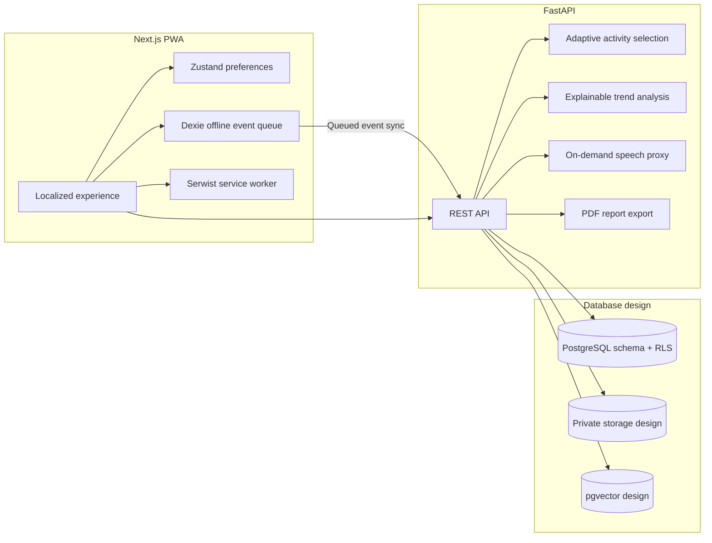

# Memora — memories that stay close 🌿

> **A calm, local-language memory companion for older adults, families, and community care teams in North East India.**<br>
> Smart India Hackathon 2026 · Problem Statement SIH26003

[](frontend/)
[](backend/)
[](frontend/locales/)

<p align="center">
  
</p>

<p align="center"><b>Local preview:</b> <a href="http://localhost:3000/en">http://localhost:3000/en</a></p>

---

## 🌱 The idea

Memora brings familiar photos, stories, songs, and activities into a gentle digital experience shaped around North East India. It is designed to help people stay connected to their memories and to help families and community care workers stay informed.

The interface is built for clarity: calm screens, readable text, large controls, local-language support, and features that can continue working when connectivity is unreliable. Memora supports reminiscence and caregiver assistance; it does not replace healthcare or make medical decisions.

## ✨ What you can explore

### 1. Patient experience

- Simple memory activities, including a culturally grounded Memory Match game.
- A family album with caregiver-provided photos and optional spoken narration.
- Reminders and a calm companion experience with microphone use initiated by an explicit tap.
- A Memory House that can show a static album when 3D rendering is unavailable or reduced motion is preferred.

### 2. Caregiver portal

- Add family photos, songs, and stories to a private memory collection.
- Review suggested reminiscence questions before they become available to the patient.
- Follow activity history and descriptive trends over time.
- Mark an unwell day so it is considered when reviewing those trends.

### 3. ASHA and community care

- View assigned people in an order informed by their recent activity trends.
- Open a detail view with the figures behind a trend summary.
- Export a concise PDF report for discussion with a healthcare professional.

Trend summaries are descriptive and can have many causes. When there is a concern, consider a check-up with a doctor.

### 4. Accessibility and language options

- Calm Mode reduces animation and switches the showcase to a static presentation.
- Text size, high contrast, voice language, read-aloud, and keyboard help are available in Settings.
- The interface includes English, Hindi, Assamese, Bengali, Bodo, and Meitei. Native-speaker review is still needed for some translations, and speech availability can vary by device and language service.

## 🖼️ A look at the roles

These local project images illustrate the three experiences; the homepage screenshot above is the actual running interface.

| Patient activities | Family memories | Community support |
|---|---|---|
|  |  |  |

## 🧭 How the app fits together



The browser client is built with Next.js and keeps an offline event queue in IndexedDB. The FastAPI service contains the activity, trend, speech, and report endpoints. The API currently uses an in-memory repository; `db/schema.sql` documents the PostgreSQL row-level-security design. Speech capture is user-initiated; raw audio is not retained by the speech service.

## 🧰 Technology

| Area | Tools |
|---|---|
| Web app | Next.js App Router, React, TypeScript, Tailwind CSS v4 |
| Localization | next-intl, self-hosted Atkinson Hyperlegible and Noto fonts |
| Offline and state | Serwist, Dexie, Zustand |
| Activities and charts | React Three Fiber / Three.js, Recharts |
| API | FastAPI, Pydantic, SQLAlchemy |
| Data design | PostgreSQL schema, Supabase-compatible storage, pgvector, row-level security |
| Testing | Vitest, pytest |

## 🚀 Run Memora locally

### Prerequisites

- Node.js 20 or later and npm
- Python 3.12 or later for the API
- Git

### Start the web app

```bash
git clone https://github.com/krishporwal011/Redesign-Memora.git
cd Redesign-Memora/frontend
npm ci
npm run dev
```

Open **http://localhost:3000/en**. Other language routes are `/hi`, `/as`, `/bn`, `/brx`, and `/mni`.

### Start the API (optional)

In another terminal, from the repository root:

```bash
cd backend
python3 -m venv .venv
source .venv/bin/activate          # Windows: .venv\Scripts\activate
pip install -r requirements.txt
uvicorn app.main:app --reload --port 8000
```

Open **http://localhost:8000/docs** for the API documentation. Some integrations need local credentials; use the environment templates and never commit secret values.

### Run the full stack with Docker

From the repository root:

```bash
docker compose up --build
```

## ✅ Checks

Run these from the relevant directories:

```bash
# Frontend
cd frontend
npm test
npx tsc --noEmit
npm run build

# Backend (activate backend/.venv first)
cd ../backend
pytest -q
python scripts/simulate.py
```

The frontend tests cover locale parity, accessible components, offline sync, adaptive activity logic, and the Memory House fallback. The backend tests cover consent gating, access isolation, event syncing, trend analysis, speech behavior, and PDF export. The simulation uses synthetic data.

## ♿ Accessibility, privacy, and safe use

- Patient screens favor predictable layouts, clear labels, readable text, and large touch targets.
- Reduced-motion preferences and Calm Mode avoid cinematic movement in patient-facing flows.
- High-contrast and text-size preferences apply across the site.
- Family media is intended for private storage; consent checks gate writes, and row-level security scopes access.
- Audio is captured only after a person taps a voice control. Raw audio is not kept by the speech service.
- Trend summaries show their supporting figures and avoid medical labels.

## 📁 Project map

```text
.
├── frontend/       Next.js PWA, localized pages, UI, and offline queue
├── backend/        FastAPI service, adaptive/trend logic, and tests
├── api/            OpenAPI contract
├── db/             PostgreSQL schema and access policies
├── docs/           Design, research, QA notes, and screenshots
└── AGENTS.md       Project context and implementation constraints
```

## 📚 More project docs

- [Design system](docs/DESIGN.md)
- [Redesign progress](docs/redesign/PROGRESS.md)
- [QA report](docs/redesign/QA_REPORT.md)
- [API contract](api/openapi.yaml)
- [Database schema](db/schema.sql)
- [Research notes](docs/research/)

---

Memora is built for the Smart India Hackathon 2026 problem statement **SIH26003**. It is a memory companion and caregiver-support project, not a medical device.
